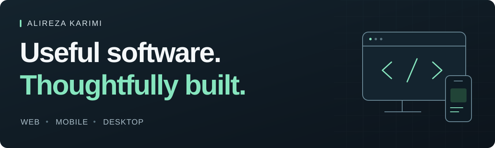

  

  <a href="https://github.com/karimialireza405/arzman-app"><strong>Explore ArzMan ↗</strong></a>
  &nbsp; · &nbsp;
  <a href="mailto:alirezkarimi0021@gmail.com">Get in touch</a>
  &nbsp; · &nbsp;
  <a href="https://orcid.org/0009-0005-1236-2687">ORCID</a>

## Hi, I'm Alireza.

I'm a software developer based in Iran, building **web, mobile and desktop applications**. I care about the details that make software useful: a clear interface, dependable data and a smooth experience in both Persian and English.

My work connects **interface design, application logic and backend services**. I enjoy taking an idea through to a working app, then refining how it feels to use.

### Featured project · ArzMan

**[ArzMan · ارز من](https://github.com/karimialireza405/arzman-app)** is a Persian-first currency dashboard for the Iranian open market, built with **React Native, Expo, TypeScript and Cloudflare Workers**.

- **24 currencies**, with Toman/Rial conversion, price history and in-app alerts.
- A shared application for **Android, iOS and the web**, with a dedicated Persian RTL experience.
- A backend that validates source data and keeps the last known good snapshot when the source is unavailable.
- Shared schemas and validation, automated checks and documentation in **English and Persian**.

[Explore the code](https://github.com/karimialireza405/arzman-app) &nbsp; / &nbsp; [Read the architecture](https://github.com/karimialireza405/arzman-app/blob/main/docs/ARCHITECTURE.md) &nbsp; / &nbsp; [راهنمای فارسی](https://github.com/karimialireza405/arzman-app/blob/main/README.fa.md)

### Tools I work with

| Area | Technologies |
| :--- | :--- |
| Web & interfaces | TypeScript · JavaScript · React · HTML · CSS |
| Mobile | React Native · Expo |
| Desktop | Tauri · Rust |
| Backend & data | Cloudflare Workers · Durable Objects · SQLite |
| Quality & delivery | Git · GitHub Actions · Vitest · ESLint |

### What I bring to a project

- **Attention to the interface.** Readable typography, clear states and interactions that make sense.
- **Persian and RTL experience.** Layout, mixed-script text, local units and bilingual documentation.
- **Care with data.** Validation at boundaries, explicit freshness and useful behavior when a source fails.
- **A complete product view.** Connecting the UI, data flow, testing and delivery.

---

<strong>معرفی فارسی</strong>

### سلام، من علیرضا کریمی هستم.

توسعه‌دهندهٔ نرم‌افزارم و برای وب، موبایل و دسکتاپ برنامه می‌سازم. برایم مهم است که یک محصول، علاوه بر ظاهر خوب، کارکرد روشن و دادهٔ قابل اتکا داشته باشد و استفاده از آن راحت باشد.

در کارهایم به طراحی رابط کاربری، تجربهٔ فارسی و راست‌به‌چپ، ارتباط درست بین بخش‌های برنامه و مستندسازی توجه می‌کنم.

یکی از پروژه‌های عمومی من **[ارز من](https://github.com/karimialireza405/arzman-app)** است؛ داشبورد فارسی نرخ ارز با نمایش ۲۴ ارز، تبدیل تومان و ریال، تاریخچهٔ قیمت و هشدار درون برنامه.

برای ارتباط دربارهٔ پروژه‌ها و ایده‌های نرم‌افزاری، از طریق **[ایمیل](mailto:alirezkarimi0021@gmail.com)** با من در تماس باشید.

  Have a project or an idea to discuss? <a href="mailto:alirezkarimi0021@gmail.com"><strong>Let's talk.</strong></a>

